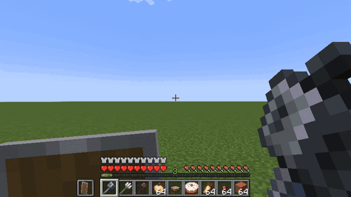

死亡随机掉落（RandomDeathDrop）

Minecraft 1.21.1：死亡时按格子随机掉落背包物品。轻量级模组，搞着玩的 :D



> 纯服务端模组：服务器装即可，客户端无需安装。

你可能发现模组ID和模组名不一样，因为我是到最后才觉得原模组名不太适合，但又不想全部重新改掉了，所以只改了模组名 ;)

**！！本模组代码由Ai编写！！**

本模组应该只支持1.21.1

该模组默认死亡时保留装备栏和快捷栏的物品，如果你想不保留它们，可以在配置文件中修改
 
 配置文件在 \config\randomdeathdrop\randomdeathdrop.json

---

## 功能

- 死亡时只掉落主背包（27 格）中随机 50% 的格子，堆叠物品整格掉落
- 快捷栏、盔甲栏、副手可配置是否保留
- 经验按等级掉落百分比（例：8 级 × 50% = 掉 4 级，重生后剩 4 级）
- 物品白名单/黑名单（全局 + 按玩家），**支持通配符**：`*` 匹配任意长度、`?` 匹配单字符
- 支持关键字 "globalWhiteList" 、 "globalBlackList" 
- 按玩家覆盖配置（名字或 UUID）
- `/randomdeathdrop reload` 或 `/rdd reload` 热重载配置（需要 OP）

## 配置

配置文件是 JSONC（支持 // 和 /* */ 注释），首次启动会生成带完整注释的模板。

| 字段 | 默认 | 说明 |
|---|---|---|
| dropPercent | 50 | 物品掉落百分比 |
| roundUp | true | 取整方向（物品和经验共用） |
| keepHotbar | true | 保留快捷栏 |
| keepSelectedSlot | true | keepHotbar=false 时保留手持格 |
| keepArmorSlot | true | 保留盔甲栏 |
| keepWeaponOffhand | true | 保留副手 |
| xpDropPercent | 100 | 经验掉落百分比（按等级），0=不掉，100=原版 |
| whiteList | true | 白名单（名单内不掉落、不计入随机，名单外随机掉落），支持 `*`/`?` |
| blackList | false | 黑名单（名单内计入随机掉落，名单外不掉落、不计入随机） |

### 通配符示例

```jsonc
// 所有木头受保护，但橡木被排除 → 只掉橡木
globalWhiteList: ["*_wood","!oak_wood"]
```

### 关键字示例

```jsonc
// 某个玩家继承全局白名单并额外保护木炭
{
  "name": "Steve", 
  "whiteList": ["globalWhiteList", "charcoal"] 
  "blackList": []
}
```

## 构建

```bash
gradlew.bat :fabric:build    # 产物 fabric/build/libs/RandomDeathDrop-fabric-*.jar
gradlew.bat :neoforge:build  # 产物 neoforge/build/libs/RandomDeathDrop-neoforge-*.jar
```

- Fabric 版依赖 Fabric API
- NeoForge 版使用 ModDevGradle + NeoForge 21.1.249
